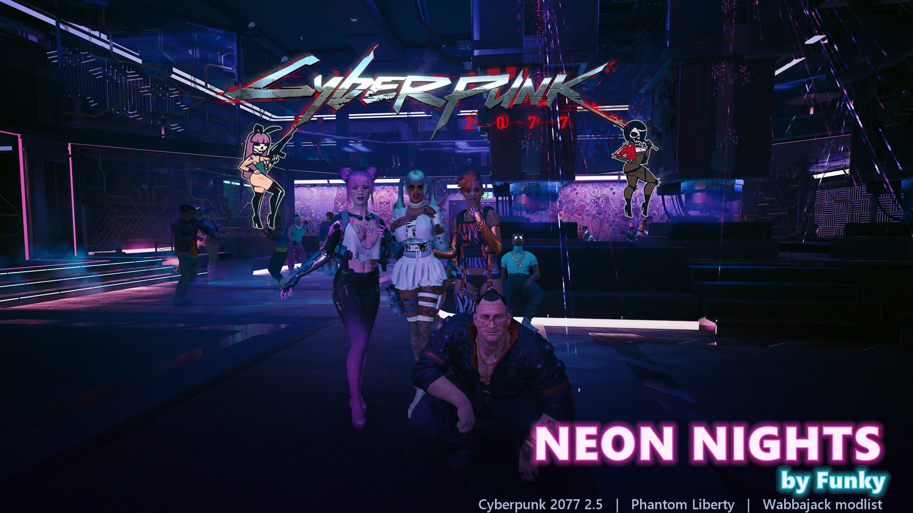

# Neon Nights

Neon Nights is a modlist for **Cyberpunk 2077** (patch 2.5 with Phantom Liberty, English language): about 390 mods picked and configured to work together. It is for players who want a more beautiful, livelier and more interesting Night City without turning it into a different game.

It is an unofficial fan modlist: it is not approved or supported by CD PROJEKT S.A.

## Features

- **Graphics and weather:** HD textures, better lighting, rain and water, color grading, distant shadows.
- **A livelier city:** street events, smarter police, taxi work, new quests and contracts, merc allies, melee, loot markers and auto-loot.
- **Apartments and cars:** upgraded apartments and new homes, supercars and classics, auto drive with a passenger seat.
- **Weapons:** a weapon in each hand, visible holstered weapons.
- **Third person:** Cyber Sight, a third-person view for combat, katana, Sandevistan and driving. Toggle it with **F1**.
- **Sandevistan and dash effects:** better visuals with ESDE.
- **Fixes and crash protection:** all needed frameworks (CET, RED4ext, redscript, ArchiveXL, TweakXL, Codeware) and fixes.

## Requirements

- Cyberpunk 2077 patch **2.5** with the **Phantom Liberty** expansion, a clean game without other mods, English language.
- The free **REDmod** DLC for Cyberpunk 2077, installed before you install the modlist (the modlist includes one REDmod-based mod, Material and Texture Override).
- Wabbajack and a Nexus Mods account. A free account is enough, but without Premium Wabbajack opens the page of every file and you press "Slow download" for each one. There are about 390 mods, so it takes a long time. With Premium everything downloads by itself.
- About 18 GB of disk space for the installed modlist and about 17 GB for the downloaded mod archives.
- Windows 10/11 (64-bit).
- Tested on: i7-13700HX, RTX 4080 Laptop, 32 GB RAM, about 40 FPS at 4K. Low FPS? Disable heavy texture mods in MO2 at your own risk.

## Installation

1. Make sure your game is a clean Cyberpunk 2077 2.5 with Phantom Liberty and the REDmod DLC, without other mods.
2. Open Wabbajack, find **Neon Nights** in the gallery and press Install.
3. Choose an empty install folder and a separate download folder, log in to Nexus Mods when asked, and wait for the downloads and the installation to finish.
4. Start the game **through Mod Organizer 2** from the install folder. The loaders (CET, RED4ext and redscript) are placed by Root Builder automatically when you start the game.

## Known issues and support

- Start the game only through Mod Organizer 2, not with the game's own shortcut or launcher: the loaders are placed at launch.
- The first launch takes a long time: scripts and shaders are rebuilt.
- The modlist was tested on one edition of the game only. Other editions were not tested.
- One crash was seen after a long session in the character creator. Save right after you create your character.
- The Responsive NPCs mod is off by default: it caused crashes in our tests. You can turn it on in Mod Organizer 2 at your own risk.
- Do not update, add or remove mods inside the modlist and do not change the load order: it may break it.
- Support: open an issue at https://github.com/funkyplaytv/neon-nights-modlist/issues.

## Credits and legal

Neon Nights is an unofficial fan modlist. It is not approved or supported by CD PROJEKT S.A.

Cyberpunk 2077 is a trademark of CD PROJEKT S.A.

All mods belong to their authors. We do not re-upload other authors' mods: they are downloaded from their authors' pages on Nexus Mods. The only exception is our own fixed build of ArchiveXL, which is released under the MIT license (license and notice: `licenses/ArchiveXL/`). Please endorse the mod authors on Nexus Mods: it is the best way to thank them.
